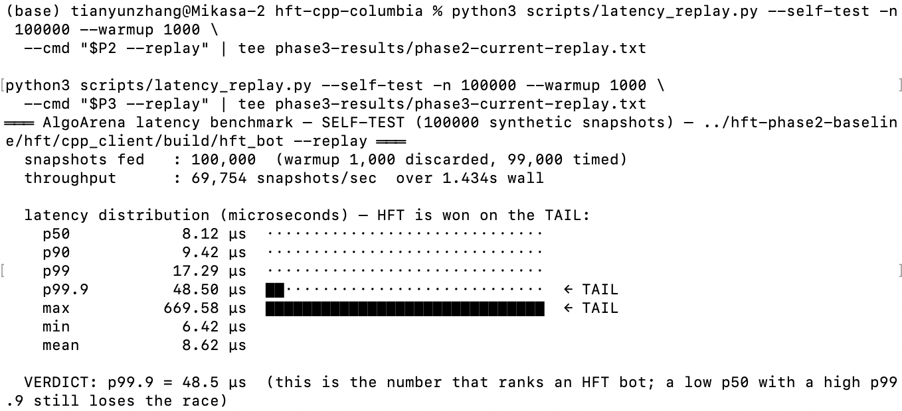
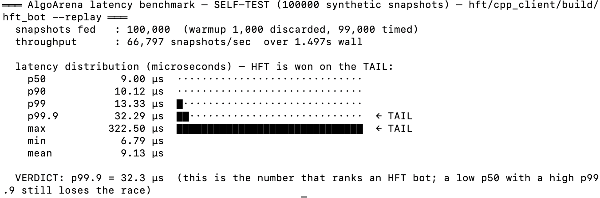
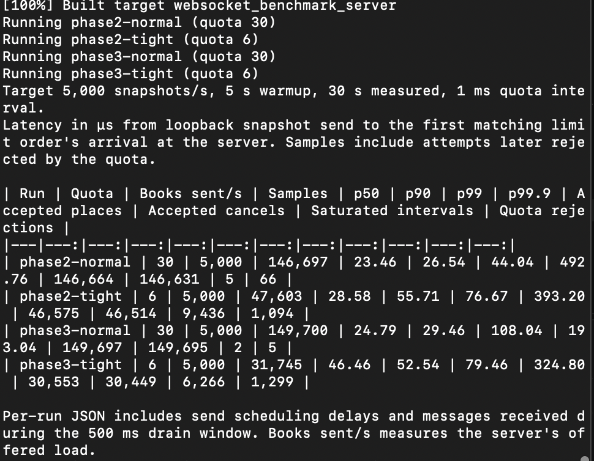

# Phase 3 — Threading to Accelerate

**Source submission** · [hft-cpp-columbia / phase3](https://github.com/ShaunWWWang/hft-cpp-columbia/tree/phase3)


## Threaded pipeline and ring-buffer design

### Live pipeline

```text
                  WebSocket / receive callback thread
                  decode frame, copy callback data
                               |
                               | publish pipeline::Event
                               v
                inbound SPSC ring (capacity 1024)
                               |
                               v
                    strategy consumer thread
                  update state, make decisions
                               |
                               | publish StrategyOrder
                               v
                 outbound SPSC ring (capacity 1024)
                               |
                               v
                      order sender thread
              encode message and call WebSocket send
```

The thread running `main()` waits for the live client to stop. IXWebSocket
provides the background thread that invokes the receive callback. The bot
starts a strategy consumer and an order sender in [SpreadCaptureBot](../hft/cpp_client/include/spread_capture_bot.hpp).
The receive callback decodes messages in [ArenaClient](../hft/cpp_client/include/arena_client_impl.hpp),
then the bot copies relevant callback data into fixed-size pipeline events and
publishes them to the inbound queue.

The strategy consumer owns and updates [SpreadStrategy](../hft/cpp_client/include/spread_strategy.hpp),
including symbol state, local books, and queue state. For a live order decision,
it copies a fixed-size `StrategyOrder` into the outbound queue. The sender thread
does the transport work separately: it converts the symbol to its reusable
string buffer, encodes the order through the client's send helpers, and asks
IXWebSocket to send it.

This separation means strategy decisions are **not run inside `on_book` on the
receive callback thread**. Parsing and message decoding still happen on that
receive thread before events reach the strategy consumer.

### SPSC queues and ownership

Both handoffs use [TypedSpscRing](../hft/cpp_client/include/typed_spsc_ring.hpp),
a bounded, power-of-two, single-producer/single-consumer ring:

| Queue | Producer | Consumer | Payload |
|---|---|---|---|
| Inbound | WebSocket receive callback | Strategy consumer | `pipeline::Event` |
| Outbound | Strategy consumer | Order sender | `StrategyOrder` |

Each queue has capacity 1024 and stores its payloads in a preallocated array.
The producer copies into a free slot and publishes the tail index with a
release store. The consumer observes that index with an acquire load, copies
the payload out, and releases the slot by advancing the head. Head and tail
indices are separately wrapped in 64-byte-aligned structures; the slot array
is also 64-byte aligned. The implementation statically requires lock-free
atomic index types.

There is exactly one producer and one consumer per queue in live mode. Do not
add another producer or consumer without changing the synchronization design.
The ring does not allocate, lock, overwrite a full slot, or wait for space.
When the inbound queue is full, the channel latches a fault and stops the bot
rather than continue with incomplete strategy state. When the outbound queue
is full, the bot stops and reports an outbound queue overflow after shutdown.

### Decision-path properties and limits

The strategy computation and its outbound handoff use fixed-size data,
preallocated symbol/state storage, and the SPSC queue. That section of the live
path is designed to be **allocation-free and lock-free**. It does not include
the whole receive-to-exchange path:

- JSON decoding and receive-side callback work happen before the inbound queue.
- Order serialization, message-pool use, and WebSocket sending happen on the
  sender thread, outside the decision path; transport internals may allocate or
  use locks.
- Shutdown reporting and diagnostic output are not part of the decision path.
- Lock-free atomic indices do not make unrelated transport or runtime code
  lock-free.

In replay mode there is no live consumer/sender pipeline: dispatch and
strategies run inline, and generated orders are captured synchronously for the
replay response.

### CPU affinity on Linux

The bot optionally pins the receive callback, strategy consumer, and order
sender to logical CPU IDs supplied by `HFT_RX_CPU`, `HFT_STRATEGY_CPU`, and
`HFT_SENDER_CPU`. Set all three to distinct IDs or leave all unset. The receive
thread is pinned when it first enters a bot callback; the strategy and sender
threads pin themselves at startup. A failed pin is reported and stops
processing. The main thread is not pinned.

For example, after choosing three distinct, online, process-allowed CPUs:

```bash
HFT_RX_CPU=10 HFT_STRATEGY_CPU=12 HFT_SENDER_CPU=14 ./build/hft_bot
```

Affinity is not CPU isolation. The operating system may still schedule other
tasks on a pinned CPU unless the host has separately configured CPU isolation
and housekeeping/IRQ placement. The selected CPUs must be online and allowed
for the process. The application does not configure boot parameters or isolate
CPUs itself.

### Shutdown order

When live `run()` returns, the WebSocket receive producer has stopped. The bot
marks the inbound producer done and joins the strategy consumer, which drains
published events. It then marks strategy production done and joins the sender,
which drains queued orders before exiting. Worker errors, pipeline faults, and
outbound queue overflow are surfaced after the corresponding threads are
joined.

## Offline latency and throughput

Both the Phase 2 baseline and Phase 3 used the same trading logic, including the EMA signal, quote placement rules, and cancellation rules based on ACKs and queue updates. Each Release binary ran once on the same Apple Silicon macOS machine with `latency_replay.py --self-test -n 100000 --warmup 1000`. Both runs received 100,000 deterministic synthetic snapshots and timed 99,000 responses after warmup.

Run the same command for each Release binary, setting `BOT` to its absolute
path.

```bash
python3 scripts/latency_replay.py --self-test -n 100000 --warmup 1000 \
  --cmd "\"$BOT\" --replay"
```


| Metric | Phase 2 baseline | Phase 3 | Change |
|---|---:|---:|---:|
| p50 | 8.12 µs | 9.00 µs | +10.84% |
| p99 | 17.29 µs | 13.33 µs | −22.90% |
| p99.9 | 48.50 µs | 32.29 µs | −33.42% |
| Maximum | 669.58 µs | 322.50 µs | −51.84% |
| Replay throughput | 69,754 snapshots/s | 66,797 snapshots/s | −4.24% |

Only 951 of the 100,000 synthetic snapshots had all depth prices on the
$0.01 grid, according to the original run notes. The workload therefore
mostly exercises invalid-book handling. This single run provides an offline latency comparison.

**Before**

**After**



## WebSocket correctness and ThreadSanitizer

The local [bot_pipeline test](../tests/bot_pipeline_test.cpp) starts a loopback
WebSocket server. It checks that the live bot emits the same limit order,
cancellation, and session-close flatten order as inline replay. It checks final
strategy state, event draining, input rejection, and shutdown.

The test and the IXWebSocket dependency were built with
`-fsanitize=thread`. With `TSAN_OPTIONS=halt_on_error=1`,
`bot_pipeline` passed **1/1 in 0.39 s**. The saved output contains no
ThreadSanitizer warnings. The normal live sequence processed 12 events with
zero reported processing errors and zero dropped latency samples. The 0.39 s
covers the entire integration test, including startup and shutdown.

```bash
cmake -S hft/cpp_client -B hft/cpp_client/build-tsan \
  -DCMAKE_BUILD_TYPE=RelWithDebInfo -DHFT_BUILD_TESTS=ON -DHFT_ENABLE_TSAN=ON
cmake --build hft/cpp_client/build-tsan --parallel
TSAN_OPTIONS=halt_on_error=1 ctest --test-dir hft/cpp_client/build-tsan \
  -R '^bot_pipeline$' -V 2>&1 | tee phase3-websocket-tsan.txt
```

[Full CTest and ThreadSanitizer output](../phase3-websocket-tsan.txt)

## Busy-tape WebSocket benchmark

The [loopback exchange](../tests/websocket_benchmark_server.cpp) sends a
fixed-rate sequence of valid, five-level books over 32 symbols. The same
synthetic tape is used in all four cases. The exchange applies a fixed quota
window to incoming place and cancel requests. It ACKs accepted placements and
sends an error for requests beyond the cap. The synthetic exchange models
quota and order feedback. It does not model fills or the course exchange's
internal tick clock.

For each measured snapshot, the server timestamps the send and samples the
first limit attempt that matches its symbol and unique touch price. The
second timestamp is taken when that message arrives back at the server,
before quota enforcement. Both accepted and rejected attempts enter the
latency population. The sample excludes snapshots with no matching limit
attempt. This measures a loopback market-data-to-order round trip, including
the bot's live pipeline.

Build the Release server and Phase 3 client, then pass the path to a Release
Phase 2 binary as `--phase2`.

```bash
cmake -S hft/cpp_client -B hft/cpp_client/build \
  -DCMAKE_BUILD_TYPE=Release -DHFT_BUILD_TESTS=ON -DHFT_ENABLE_TSAN=OFF
cmake --build hft/cpp_client/build --target hft_bot websocket_benchmark_server --parallel
python3 scripts/websocket_benchmark.py \
  --server hft/cpp_client/build/websocket_benchmark_server \
  --phase2 ../hft-phase2-baseline/hft/cpp_client/build/hft_bot \
  --phase3 hft/cpp_client/build/hft_bot \
  --rate 5000 --warmup 5 --seconds 30 --interval-ms 1 \
  --normal-quota 30 --tight-quota 6 --output phase3-quota-results
```

It reports the actual feed rate and send scheduling
delays. The Phase 3 pipeline event total provides an end-of-run delivery check
against the books, session-open event, ACKs and errors sent by the server.

### Results

Each case sent 25,000 warmup and 150,000 measured snapshots at approximately
5,000 snapshots/s. The local quota reset every 1 ms. Latencies are in µs.

| Run | Quota | Books sent/s | Samples | p50 | p90 | p99 | p99.9 | Accepted places | Accepted cancels | Saturated intervals | Quota rejections |
|---|---:|---:|---:|---:|---:|---:|---:|---:|---:|---:|---:|
| phase2-normal | 30 | 5,000 | 149,700 | 25.96 | 28.33 | 43.96 | 192.11 | 149,697 | 149,694 | 1 | 6 |
| phase2-tight | 6 | 5,000 | 37,687 | 41.25 | 53.12 | 147.25 | 2,154.63 | 36,564 | 36,403 | 7,569 | 1,287 |
| phase3-normal | 30 | 5,000 | 141,547 | 27.38 | 58.21 | 151.96 | 2,188.41 | 141,463 | 141,379 | 10 | 168 |
| phase3-tight | 6 | 5,000 | 42,871 | 44.46 | 52.42 | 139.74 | 2,395.37 | 41,799 | 41,642 | 8,445 | 1,229 |




