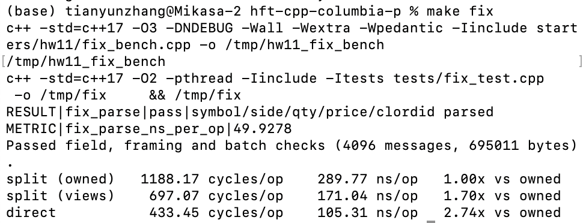

# HW11 — A high-performance FIX parser

**Source submission** · [hft-cpp-columbia-p / hw11](https://github.com/tz2692-star/hft-cpp-columbia-p/tree/hw11)

The [parser](../../include/fix_parser.hpp) decodes each field directly from the receive buffer with no per-order heap allocation. ClOrdID borrows its bytes from that buffer, so consume it before reusing the storage. For concatenated orders, `fix::next_new_order` uses BodyLength and the SOH-delimited trailer to advance one frame at a time. A TCP reader retains an incomplete tail for the next read. A UDP reader processes each datagram independently.

## Run
From the repository root, run:
```sh
make fix
c++ -std=c++17 -O3 -DNDEBUG -Wall -Wextra -Wpedantic -Iinclude starters/hw11/fix_bench.cpp -o /tmp/hw11_fix_bench
/tmp/hw11_fix_bench
```
One operation consumes one framed order. The benchmark prebuilds 4,096 distinct orders (695,011 bytes), checks all five decoded fields against the generated inputs and warms up each parser. Each sample frames and parses the tape 16 times, for 65,536 orders. The table gives the median of nine samples per version, rotating their order. Timed work includes framing, field decoding and consuming the output. macOS cycle measurements use the process CPU cycle counter (`proc_pid_rusage`, `ri_cycles`), and wall time uses `steady_clock`. On Linux the benchmark requests user-mode hardware CPU cycles through `perf_event_open`. Run with `--check` for correctness checks alone.

## Environment
The measurements below were taken on macOS 15.2 (arm64) with Apple Clang 16.0.0 and GNU Make 3.81.


## Results

The single-pass parser took **433.45 CPU cycles/order** (**105.31 ns/order**) on the Apple M4, a **2.74× speedup** over the owned-string baseline. All field, framing and batch checks passed for the 4,096-order batch. The course test also passed, reporting **49.9278 ns/op** for repeated parsing of its single fixed message.

| Batch implementation | CPU cycles/order | ns/order | Throughput (million orders/s) | Speedup over baseline (cycles) |
|---|---:|---:|---:|---:|
| Baseline: split into `vector<string>` | 1,188.17 | 289.77 | 3.45 | 1.00× |
| Before: split into `vector<string_view>` | 697.07 | 171.04 | 5.85 | 1.70× |
| After: decode each field as it arrives | 433.45 | 105.31 | 9.50 | 2.74× |



**Borrowing field contents produced the largest measured gain.** Switching from owned strings to string views eliminated per-field string copies while keeping the same split-and-decode loop, saving **491.10 cycles/order**. Decoding directly into `NewOrder` then removed the temporary vector and its second traversal, saving a further **263.62 cycles/order**. All three versions used the same framer and field conversions.
